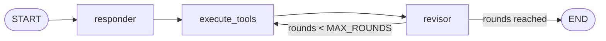

# Reflexion Agent with LangGraph, Ollama and Tavily

A modular **Reflexion agent**: it answers a question, critiques its own answer, **searches the web**
to fill the gaps, and rewrites the answer using the search results, with source URLs.

It runs on a small local model (`qwen3:1.7b` through [Ollama](https://ollama.com/)), uses
[Tavily](https://tavily.com/) for search, and is built with
[LangGraph](https://docs.langchain.com/oss/python/langgraph/overview). Every concern lives in its
own file.

This is a learning project. The goal is to understand each moving part, not to ship the best
possible answers from a 1.7B model.

---

## Table of contents

1. [What it does](#what-it-does)
2. [Reflection vs Reflexion](#reflection-vs-reflexion)
3. [How it works](#how-it-works)
4. [Project structure and layers](#project-structure-and-layers)
5. [Setup and run](#setup-and-run)
6. [File-by-file guide](#file-by-file-guide)
7. [Code reference](#code-reference)
8. [Test scripts](#test-scripts)
9. [Example run](#example-run)
10. [Design decisions](#design-decisions)
11. [Lessons learned](#lessons-learned)
12. [Known limitations](#known-limitations)
13. [Troubleshooting](#troubleshooting)
14. [Roadmap](#roadmap)
15. [Studying this project with an assistant](#studying-this-project-with-an-assistant)

---

## What it does

Input: a question, for example `What does LangGraph persistence do?`

Output: a short answer, a list of source URLs, and the number of revisions made.

```
question → draft answer → search the web → revised answer (with sources) → search again → final answer
```

---

## Reflection vs Reflexion

| | Reflection (project `07`) | Reflexion (this project) |
|---|---|---|
| Critique comes from | A second LLM role (reviewer) | The writer critiquing its own answer |
| Evidence | None, only the model's own knowledge | **Web search results** |
| Feedback format | Free text | **Structured fields** (Pydantic schema) |
| Output | A rewritten draft | A revised answer **with references** |
| Main weakness fixed | | Writer and reviewer shared the same blind spots |

In `07`, the reviewer approved a wrong claim because it had no way to check anything. Reflexion
adds the missing piece: the critique tells the agent **what to look up**, and the search supplies
**real information** to rewrite from.

### Mapping `07` roles to `08` nodes

| `07` role | `08` node | Notes |
|---|---|---|
| Generator | `responder` (first draft), `revisor` (every rewrite) | Same job: writing |
| Reviewer | none | The critique now lives inside each writer's output |
| none | `execute_tools` | The only node that uses an external tool. It is not an LLM |

The model only **suggests** search queries. Your code **runs** them.

---

## How it works



### The three nodes

| Node | LLM call? | Reads from state | Writes to state |
|---|---|---|---|
| `responder` | Yes | `question` | `answer`, `missing`, `superfluous`, `search_queries`, `rounds` (set to 0) |
| `execute_tools` | **No** (plain Python plus the Tavily API) | `search_queries` | `search_results` |
| `revisor` | Yes | `question`, `answer`, `search_results`, `rounds` | `answer`, `missing`, `superfluous`, `search_queries`, `references`, `rounds` + 1 |

The revisor deliberately does **not** read `missing` and `superfluous`. See
[Design decisions](#design-decisions).

### State

The graph uses a custom `TypedDict` (`ReflexionState`) with one named key per piece of
information. None of the keys has a reducer, so **each new value replaces the old one**. The state
always holds the latest answer, not the history.

### A run with `MAX_ROUNDS = 2`

| Step | Node | LLM calls so far | Searches so far | `rounds` |
|---|---|---|---|---|
| 1 | `responder` | 1 | 0 | 0 |
| 2 | `execute_tools` | 1 | 1 | 0 |
| 3 | `revisor` | 2 | 1 | 1 |
| 4 | router: 1 < 2, loop back | | | |
| 5 | `execute_tools` | 2 | 2 | 1 |
| 6 | `revisor` | 3 | 2 | 2 |
| 7 | router: 2 >= 2, `END` | | | |

Total: 3 LLM calls and 2 searches.

### Define vs run

Importing a module builds objects (chains, the graph) but never calls the model. Only
`.invoke(...)` or `.stream(...)` does. This is why importing `chains.py`, `nodes.py` or
`graph.py` is fast and safe.

---

## Project structure and layers

```
08-reflexion-agent/
├── llm.py            # the model
├── schemas.py        # Pydantic forms the model must fill in
├── prompts.py        # system prompts for responder and revisor
├── chains.py         # prompt + model + schema, as callable chains
├── tools.py          # web search function (Tavily)
├── state.py          # what the graph carries between nodes
├── config.py         # node names and MAX_ROUNDS
├── nodes.py          # responder, execute_tools, revisor
├── graph.py          # wiring, router, compile
├── main.py           # entry point
├── check_*.py        # test scripts (not part of the app)
├── pydantic_demo.py  # small Pydantic demo (not part of the app)
├── .env              # TAVILY_API_KEY (never commit)
├── .gitignore
├── pyproject.toml
└── README.md
```

Imports point one way only, which prevents circular imports:

```
main.py → graph.py → nodes.py → chains.py → (llm.py, prompts.py, schemas.py)
                  ↘           ↘
                   config.py   tools.py
                   state.py
```

| Layer | Files | Job |
|---|---|---|
| 1. Ingredients | `llm.py`, `schemas.py`, `prompts.py`, `tools.py`, `state.py`, `config.py` | Raw building blocks |
| 2. Recipes | `chains.py` | Combine prompt, model and schema |
| 3. Stations | `nodes.py` | One graph step per function |
| 4. Floor plan | `graph.py` | Order of steps and the stop rule |
| 5. Entry | `main.py` | Run it |

**Terms:** a *module* is a `.py` file that other files import. A *script* is a `.py` file you
run directly. A *class* (for example `AnswerQuestion`) lives inside a file.

---

## Setup and run

### Prerequisites

- Python 3.11 or newer
- [uv](https://docs.astral.sh/uv/)
- [Ollama](https://ollama.com/) installed and running
- A Tavily API key

### Install

```bash
uv add langgraph langchain-core langchain-ollama langchain-tavily pydantic python-dotenv
ollama pull qwen3:1.7b
```

> Use `python-dotenv`, not `dotenv`. They are different packages, and
> `from dotenv import load_dotenv` comes from `python-dotenv`.

### Environment

Create `.env` in the project root:

```
TAVILY_API_KEY=your_key_here
```

How the key reaches the class: `load_dotenv()` copies each line of `.env` into `os.environ`. The
`TavilySearch` class then looks up `TAVILY_API_KEY` itself when it is created. So `load_dotenv()`
must run **before** `TavilySearch(...)`, and the variable name must match exactly.

### Run

```bash
uv run main.py
uv run main.py "How do LangGraph checkpointers work?"
```

---

## File-by-file guide

Each row says what the file is for and what to understand in it. See
[Studying this project with an assistant](#studying-this-project-with-an-assistant) for how to use
this table.

| File | Purpose | Key idea to understand |
|---|---|---|
| `llm.py` | Creates the one shared `ChatOllama` object | Temperature `0` makes structured output stable and repeatable |
| `schemas.py` | Defines the forms the model fills in | A schema is an **empty labeled form**, not content. Field descriptions are instructions to the model |
| `prompts.py` | System prompts and prompt templates | `MessagesPlaceholder` is the slot where the input messages go. Without it the model never sees the question |
| `chains.py` | `prompt \| llm.with_structured_output(Schema)` | Read `\|` as "then". The result is a filled Pydantic object, not an `AIMessage` |
| `tools.py` | Runs searches and returns one text block with URLs | The model only suggests queries. This code runs them. Limits live in code (`[:3]`) |
| `state.py` | `ReflexionState`, the data carried between nodes | Keys without a reducer **overwrite** instead of append |
| `config.py` | Node-name constants and `MAX_ROUNDS` | Constants stop a typo in a string from hiding. One edit changes loop length |
| `nodes.py` | The three graph steps | A node reads some keys, does one step and returns **only the keys that changed** |
| `graph.py` | Wires nodes and the stop rule | A router returns the **name** of the next node, or `END`. `compile()` locks the design |
| `main.py` | Reads the question, runs the graph, prints results | `if __name__ == "__main__":` keeps imports from starting a run |

---

## Code reference

### `llm.py`

```python
from langchain_ollama import ChatOllama

MODEL = "qwen3:1.7b"

llm = ChatOllama(model=MODEL, temperature=0)
```

### `schemas.py`

```python
from typing import List
from pydantic import BaseModel, Field


class Reflection(BaseModel):
    missing: str = Field(
        description="ONE sentence: the most important fact the answer is missing."
    )
    superfluous: str = Field(
        description="ONE sentence: what in the answer is unnecessary. Write 'nothing' if there is none."
    )


class AnswerQuestion(BaseModel):
    answer: str = Field(
        description="Plain-text answer in 2 to 4 sentences. No emojis, no markdown."
    )
    reflection: Reflection = Field(description="A short critique of your own answer.")
    search_queries: List[str] = Field(
        description="1 to 3 web search queries written as plain words separated by spaces."
    )


class ReviseAnswer(AnswerQuestion):
    references: List[str] = Field(
        description="URLs of the sources used. Only URLs that appeared in the search results."
    )
```

- `Reflection` is **nested** inside `AnswerQuestion` (a form inside a form).
- `ReviseAnswer` **inherits** from `AnswerQuestion` and adds one box, `references`.

### `prompts.py`

```python
from langchain_core.prompts import ChatPromptTemplate, MessagesPlaceholder

RESPONDER_SYSTEM = (
    "You are an expert researcher. Fill in the structured fields as follows.\n"
    "- answer: 2 to 4 plain sentences answering the question. "
    "ONLY the answer. Never put the critique or search queries here.\n"
    "- reflection.missing: ONE sentence naming the most important missing fact.\n"
    "- reflection.superfluous: ONE sentence about what is unnecessary, or 'nothing'.\n"
    "- search_queries: 1 to 3 queries written as plain words separated by spaces, "
    "for example: LangGraph checkpointer persistence. No hyphens.\n"
    "If you are not sure about a fact, say so in the answer instead of guessing."
)

REVISOR_SYSTEM = (
    "You are an expert researcher revising an answer. You will receive the question, "
    "your previous answer, and web search results. Fill in the fields:\n"
    "- answer: 2 to 4 plain sentences. Rebuild the answer from the search results. "
    "Use ONLY facts the search results support, and delete any sentence from the "
    "previous answer that they do not support. Explain the core concept first. "
    "ONLY the answer here.\n"
    "- reflection.missing: ONE sentence on what is still missing from YOUR NEW answer.\n"
    "- reflection.superfluous: ONE sentence on any claim in YOUR NEW answer that the "
    "search results do not support, or 'nothing'.\n"
    "- search_queries: 1 to 3 queries as plain words separated by spaces, "
    "for anything still unclear.\n"
    "- references: only URLs that appear in the search results. Never invent a URL.\n"
    "Rules: mention a vendor-specific or third-party example only if the question "
    "asks for it. Prefer official documentation. Do not mention any source or example "
    "that is not in the search results."
)

responder_prompt = ChatPromptTemplate.from_messages([
    ("system", RESPONDER_SYSTEM),
    MessagesPlaceholder(variable_name="messages"),
])

revisor_prompt = ChatPromptTemplate.from_messages([
    ("system", REVISOR_SYSTEM),
    MessagesPlaceholder(variable_name="messages"),
])
```

Python joins neighboring string literals **exactly as written**, so every piece must end with a
space or `\n`. Print `REVISOR_SYSTEM` to check the join.

### `chains.py`

```python
from llm import llm
from prompts import responder_prompt, revisor_prompt
from schemas import AnswerQuestion, ReviseAnswer

responder_chain = responder_prompt | llm.with_structured_output(AnswerQuestion)
revisor_chain = revisor_prompt | llm.with_structured_output(ReviseAnswer)
```

### `tools.py`

```python
from dotenv import load_dotenv
load_dotenv()   # must run BEFORE TavilySearch is created

from langchain_tavily import TavilySearch

tavily = TavilySearch(max_results=2)


def perform_search(queries: list[str]) -> str:
    blocks = []
    for query in queries[:3]:                 # hard limit: at most 3 queries
        query = query.replace("-", " ")
        response = tavily.invoke({"query": query})
        for r in response["results"]:
            url = r.get("url")
            if not url:
                continue                      # skip results with no URL
            blocks.append(f'Source: {url}\n{r.get("content", "")}')
    return "\n\n".join(blocks)                # after the loop, not inside it
```

Each block keeps its URL next to its text, so the revisor can only cite URLs it was shown.

### `state.py`

```python
from typing import List, TypedDict


class ReflexionState(TypedDict, total=False):
    question: str
    answer: str
    missing: str
    superfluous: str
    search_queries: List[str]
    search_results: str
    references: List[str]
    rounds: int
```

`total=False` makes every key optional, because only `question` exists at the start.

### `config.py`

```python
RESPONDER = "responder"
EXECUTE_TOOLS = "execute_tools"
REVISOR = "revisor"

MAX_ROUNDS = 2   # number of revisions
```

### `nodes.py`

```python
from langchain_core.messages import HumanMessage

from chains import responder_chain, revisor_chain
from state import ReflexionState
from tools import perform_search


def responder_node(state: ReflexionState):
    result = responder_chain.invoke(
        {"messages": [HumanMessage(content=state["question"])]}
    )
    return {
        "answer": result.answer,
        "missing": result.reflection.missing,
        "superfluous": result.reflection.superfluous,
        "search_queries": result.search_queries[:3],
        "rounds": 0,
    }


def execute_tools_node(state: ReflexionState):
    return {"search_results": perform_search(state["search_queries"])}


def revisor_node(state: ReflexionState):
    text = (
        f"Question:\n{state['question']}\n\n"
        f"Previous answer:\n{state['answer']}\n\n"
        f"Search results:\n{state['search_results']}"
    )
    result = revisor_chain.invoke({"messages": [HumanMessage(content=text)]})

    # Keep only URLs that really appear in the search results
    valid_refs = [u for u in result.references if u in state["search_results"]]

    return {
        "answer": result.answer,
        "missing": result.reflection.missing,
        "superfluous": result.reflection.superfluous,
        "search_queries": result.search_queries[:3],
        "references": valid_refs,
        "rounds": state.get("rounds", 0) + 1,
    }
```

### `graph.py`

```python
from langgraph.graph import StateGraph, START, END

from config import EXECUTE_TOOLS, MAX_ROUNDS, RESPONDER, REVISOR
from nodes import execute_tools_node, responder_node, revisor_node
from state import ReflexionState


def should_continue(state: ReflexionState):
    if state["rounds"] >= MAX_ROUNDS:
        return END
    return EXECUTE_TOOLS


builder = StateGraph(ReflexionState)

builder.add_node(RESPONDER, responder_node)
builder.add_node(EXECUTE_TOOLS, execute_tools_node)
builder.add_node(REVISOR, revisor_node)

builder.add_edge(START, RESPONDER)
builder.add_edge(RESPONDER, EXECUTE_TOOLS)
builder.add_edge(EXECUTE_TOOLS, REVISOR)
builder.add_conditional_edges(REVISOR, should_continue, [EXECUTE_TOOLS, END])

graph = builder.compile()
```

### `main.py`

```python
import sys

from graph import graph

DEFAULT_QUESTION = "What does LangGraph persistence do?"


def main():
    question = " ".join(sys.argv[1:]) or DEFAULT_QUESTION
    result = graph.invoke({"question": question})

    print("QUESTION:", question)
    print("\nANSWER:\n", result["answer"])
    print("\nSOURCES:")
    for url in result["references"]:
        print(" -", url)
    print("\nREVISIONS:", result["rounds"])


if __name__ == "__main__":
    main()
```

---

## Test scripts

These are **scripts you run directly**, not part of the app. Deleting them would not change the
app. Each one tests one layer, so a failure points to one place.

| Script | Tests | Needs |
|---|---|---|
| `check_schema.py` | Can the model fill the `AnswerQuestion` form? | Ollama |
| `check_responder.py` | Does `responder_chain` return clean fields? | Ollama |
| `check_revisor.py` | Does `revisor_chain` use hand-written search text and copy a real URL? | Ollama |
| `check_tools.py` | Does Tavily return `results` with `url` and `content`? | Tavily key |
| `check_nodes.py` | Do the three nodes return the keys in the design table, with `rounds` and overwriting working? | Ollama, Tavily |
| `check_graph.py` | Does the graph print a correct diagram and run nodes in the expected order? | Ollama, Tavily |
| `check_claims.py` | Do chosen phrases in the final answer appear in the search text? | Ollama, Tavily |
| `pydantic_demo.py` | Pydantic basics with no AI: class vs object, type checking | Nothing |

```bash
uv run check_responder.py
```

Test order used while building: schema, responder, revisor, tools, nodes, graph, then `main.py`.

---

## Example run

```
$ uv run main.py

QUESTION: What does LangGraph persistence do?

ANSWER:
 LangGraph persistence enables agents to retain state across graph runs, allowing
 resumption of conversations, recovery from interruptions, and continuity of workflows.
 It uses checkpointers for short-term memory (e.g., InMemorySaver) and stores for
 long-term memory (e.g., InMemoryStore). ...

SOURCES:
 - https://docs.langchain.com/oss/python/langgraph/persistence
 - https://pub.towardsai.net/persistence-in-langgraph-deep-practical-guide-...

REVISIONS: 2
```

With temperature `0`, the same question gives the same answer on the same setup. Exact text
depends on the model and on what Tavily returns that day.

---

## Design decisions

| Decision | Reason |
|---|---|
| Structured output (`with_structured_output`) instead of forced tool calls | `ChatOllama` ignores `tool_choice` in `bind_tools`, so a tool call cannot be forced. A Pydantic class returns a validated object instead |
| Custom `execute_tools` node, not `ToolNode` | The search queries come from a Pydantic object, not from an `AIMessage` with `tool_calls` |
| Custom `TypedDict` state, not `MessagesState` | Each piece of data gets its own named key. Easy to read and print |
| Revisor does **not** receive its old critique | A 1.7B model echoed the old critique instead of critiquing its new answer. Dropping it gave cleaner output |
| `references` filtered in code | Keeps only URLs that appear in the search text, so an invented URL cannot pass |
| Query list sliced in code (`[:3]`) | Limits cannot be ignored by the model the way a prompt instruction can |
| Hyphens replaced in queries | Small models sometimes return `a-b-c` style queries |
| Temperature `0` | More stable structured output, and repeatable test runs |
| Node names as constants | A typo in a string cannot hide |
| Fixed round limit as the stop rule | Simple and predictable |

---

## Lessons learned

| Lesson | What happened |
|---|---|
| **A schema is a form, not content** | Sample strings in a test script were mistaken for real data. The model fills the form. Descriptions are instructions to it |
| **Field descriptions steer small models** | Short, concrete wording ("ONE sentence", "No emojis") fixed over-long and over-formatted output |
| **A numbered task list leaks into one field** | The model wrote critique and queries inside `answer`. Describing what each field holds fixed it |
| **Hard limits belong in code** | The model returned 5 queries when asked for 1 to 3. A slice cannot be ignored |
| **Small models reuse everything in their input** | Old critiques and old answers were echoed back. Trimming the input helped twice |
| **A model's judgment of its own output is not evidence** | It wrote "nothing unnecessary" about an answer with unsupported phrases |
| **Grounded is not the same as relevant** | The first search returned a vendor blog, and the answer became about Oracle. Source selection matters |
| **A verified source list is not a verified answer** | An unsupported sentence survived after its URL was correctly filtered out. Code can check URLs, not sentences |
| **Indentation can hide a bug** | A `return` inside the `for` loop ran only the first query |
| **Importing runs top-level code** | Modules should define things, not do things |
| **Env vars are pulled, not pushed** | `load_dotenv()` fills `os.environ`. The class looks the key up when it is created |
| **Adjacent strings join with no space** | Sentences glued together in a prompt. Print the final prompt to check |
| **Prompts drift out of sync with code** | The prompt still mentioned a critique after the code stopped sending it |
| **Reading the output is the real test** | Every real bug was found by comparing a sentence with its source |

---

## Known limitations

- **Model size.** `qwen3:1.7b` is weak at following strict rules and at grading itself. Trust order:
  references (filtered in code) over answer over search queries over critique text.
- **Sentences are not verified.** Only URLs are. Read the answer against the sources.
- **Carry-over from the first draft.** A phrase the model wrote from memory can survive a rewrite.
- **Unused final-round queries.** The last revisor writes new queries that nothing searches.
- **Search quality.** Results can include third-party blogs, and the agent trusts what it is given.
- **Cost and speed.** Three LLM calls and two searches per question, far more than one prompt.
- **No history.** Overwriting keys means earlier drafts are not kept.

---

## Troubleshooting

| Symptom | Likely cause | Fix |
|---|---|---|
| Missing `TAVILY_API_KEY` error | `.env` not loaded, or key name wrong | Call `load_dotenv()` before creating `TavilySearch`, and check the exact name |
| `ImportError` or circular import | A lower file imports a higher one | Follow the one-way import diagram |
| Fewer sources than expected | `return` inside the `for` loop | Put `return` after the loop |
| `references` is an empty list | Model changed or invented a URL, so the filter removed it | Run twice. Check `search_results` for the exact URL |
| `answer` contains critique or queries | Prompt lists steps instead of field contents | Describe each field's content |
| Output unrelated to the question | `MessagesPlaceholder` missing | Add it to both prompts |
| Connection refused | Ollama not running | Start Ollama and check `ollama list` |
| `ValidationError` or `None` from a chain | The small model could not fill the form | Simplify field descriptions and re-run `check_schema.py` |
| Graph runs the wrong number of steps | `MAX_ROUNDS` or the router comparison | Check `config.py` and `should_continue` |
| Sentences glued together in a prompt | Missing space between string pieces | Print the prompt and add spaces |

Quick prompt check:

```python
from prompts import REVISOR_SYSTEM
print(REVISOR_SYSTEM)
```

---

## Roadmap

- [ ] Compare results across model sizes, using the same questions
- [ ] Add a rule that drops sentences with no support in the search text
- [ ] Skip the final-round search queries that nothing uses
- [ ] Try restricting search domains (for example official docs only) for documentation questions
- [ ] Keep draft history with a reducer key
- [ ] Add a checkpointer so a run can be resumed
- [ ] Add an early-stop rule when the revisor finds nothing missing

---

## Studying this project with an assistant

The [file-by-file guide](#file-by-file-guide) is meant to be used as a study index. Name a file,
and ask about it. For example:

| You say | You get |
|---|---|
| "Explain `schemas.py` from scratch" | The idea first, then the code line by line |
| "Walk through `nodes.py` with an example state" | What each node reads and returns, step by step |
| "Why does `graph.py` use `add_conditional_edges`?" | The router and the loop explained |
| "Test `tools.py` for me" | A small script to check that file alone |
| "Compare `chains.py` here with `07`" | The differences, and why they exist |

Suggested reading order, from the bottom layer upward:

1. `schemas.py` and `llm.py`
2. `prompts.py` and `chains.py`
3. `tools.py`
4. `state.py` and `config.py`
5. `nodes.py`
6. `graph.py`
7. `main.py`

Then run the matching `check_*.py` script after each one.

---

## License

Add a license of your choice before publishing.